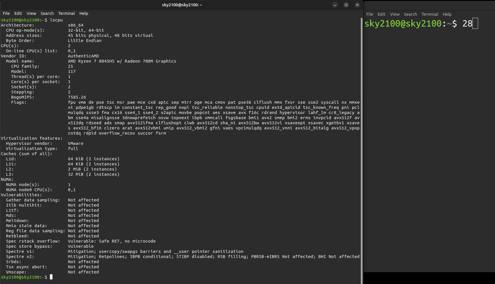
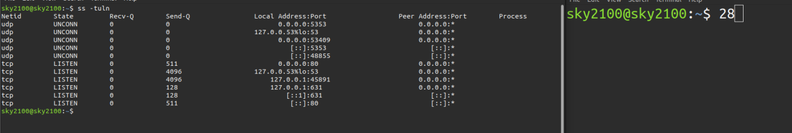
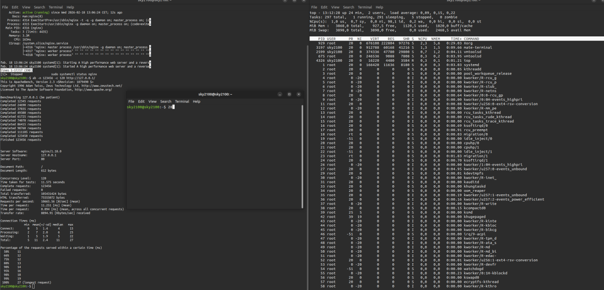
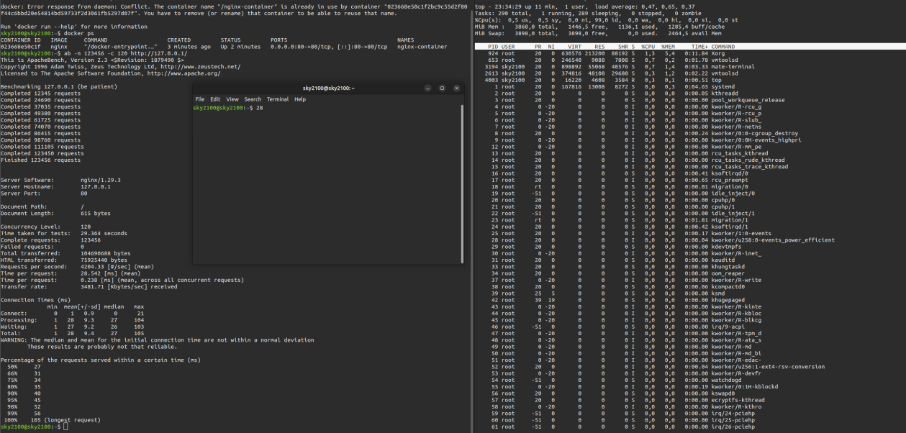
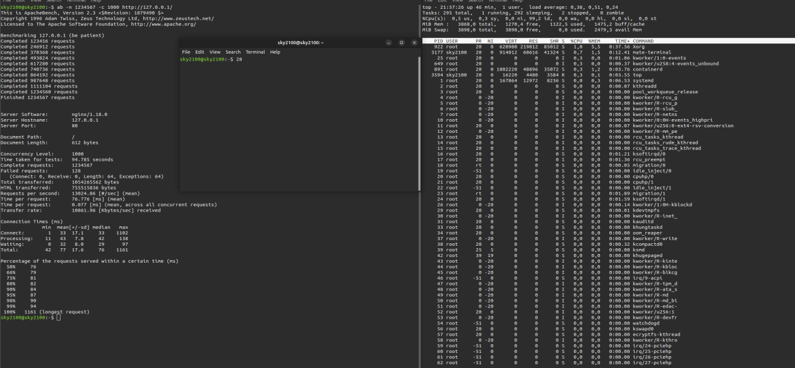
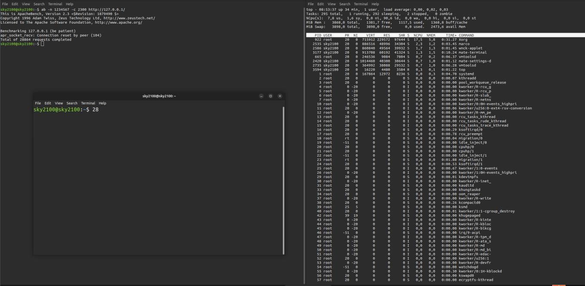
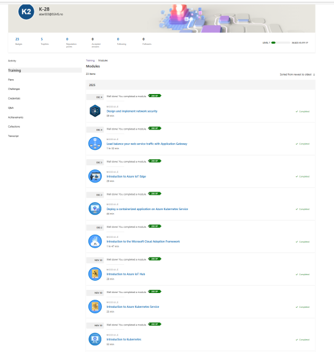

# Skysikkerhet i Azure

Design av en sikker skyarkitektur som oppfyller regelverket, for et fiktivt mobilitetsselskap, pluss praktisk ytelsestesting med Linux og Docker.

## Oversikt

Casen var NordicRide, en plattform for deling av sparkesykler og sykler i flere nordiske byer, med sanntidssporing av posisjon, betalinger og brukerprofiler. Oppgaven var å designe grunnmuren i skyen, håndtere personvern og regelverk ved internasjonal vekst, og underbygge det med praktisk testing.

## Del A: Arkitektur og styring

- **Tjenestemodell** – PaaS som ryggrad for kjernetjenestene (automatisk skalering når trafikken topper seg i rushtiden), SaaS for støtteverktøy og minimalt med IaaS, bare der det virkelig trengs direkte kontroll, begrunnet med modellen for delt ansvar fra Cloud Security Alliance
- **Utrulling** – offentlig sky med arkitektur over flere regioner for lav forsinkelse og robusthet
- **Personvern og GDPR** – data om brukere i EU holdes i EU-regioner, med styring av datalokasjon og tilgang på tvers av regioner, og **Azure Policy, Azure Blueprint og Azure Compliance Manager** brukes til å håndheve regler og dokumentere etterlevelse
- **Sikker utviklingsprosess (Secure SDLC)** – et sikkerhetsopplæringsprogram over fire uker som bygger sikkerhet inn i alle faser av utviklingen, basert på Microsoft Security Development Lifecycle
- **NIST CSF 2.0** – alle seks funksjonene (Govern, Identify, Protect, Detect, Respond, Recover) koblet til konkrete driftsrutiner for plattformen

## Del B: Praktisk lab

- Satte opp Ubuntu i VMware og undersøkte systemet (`lscpu`, `ss -tuln`)
- Kjørte en **lasttest i DDoS-stil** mot Nginx med ApacheBench, mens CPU-bruken ble overvåket med `top`
- Gjentok testen med Nginx i en **Docker-container** og sammenlignet ytelsen; containeren ga ingen merkbar ekstra belastning
- Økte antall samtidige forbindelser til serveren sviktet, og forklarte deretter hvordan lastbalansering og automatisk skalering ville håndtert belastningen i produksjon

## Skjermbilder fra laben

Undersøkelse av systemet, `lscpu` og åpne porter med `ss -tuln`:

Lasttesting av Nginx med ApacheBench, direkte og inne i en Docker-container:

Økning av samtidige forbindelser: 1000 fullføres, 2300 feiler etter 28 864 forespørsler:

Fullførte opplæringsmoduler i Azure:

## Verktøy og begreper

Microsoft Azure (Policy, Blueprint, Compliance Manager) · NIST CSF 2.0 · GDPR · Cloud Security Alliance · Ubuntu / Linux · Docker · Nginx · ApacheBench · Microsoft SDL

## Hva jeg lærte

Dette er prosjektet som fikk meg til å velge skysikkerhet som karrierevei. Å designe for skalering, regelverk og feilsituasjoner på samme tid, og så bevise en del av det i en lab, er akkurat den typen arbeid jeg vil gjøre.
